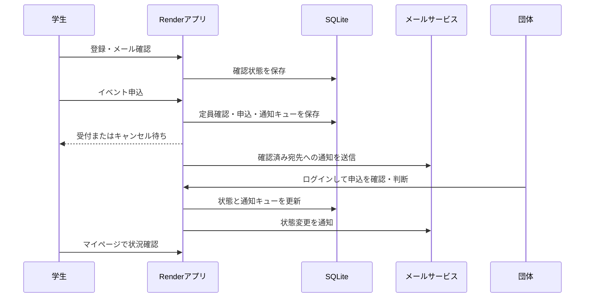

# 最新方針への案内

2026年11月7日更新：最上位目標と実行順の正本は [GOALS.md](../GOALS.md)、最新実績は [進捗ログ](progress.md)。以下は再開時の復元資料であり、古い未マージ表記・期限未定表記より最新記録を優先する。

# ワセサークルナビ 再開企画書・開発計画

2026年11月7日（日本時間）復元版。失われた旧企画書の原本ではなく、ユーザーの写真・説明と残存コードから再構成した案。

## 1. 目的
早稲田大学の新入生が、時間・費用・規模・参加条件からサークルの違いを理解し、体験イベントへの参加まで迷わず進める。
団体には掲載・イベント受付・申込対応の窓口を提供し、個別の問い合わせ往復を減らす。

## 2. 初回公開の範囲（提案）
- 学生：登録不要の検索、時間割・比較、団体情報とイベント閲覧、個人登録、申込、状況確認、取消。
- 団体：団体登録、運営の確認、イベント作成・受付、申込一覧、承認・見送り、定員・キャンセル待ち。
- 運営：団体情報の確認・公開、利用者管理、インポート・出力、問い合わせ対応。
- 通知：メール確認後の受付・状態変更と団体への新着通知。実送信確認を通してから有効化する。

DM、質問箱、レビュー、学校公認・企業支援、収益化は未決定。初回公開の必須条件にはせず、ユーザーと団体の試用結果を見て決める。Google検索への登録と広告掲載は別であり、現在確認すべきものはSearch Console。

## 3. 事実・実装状況
- 新版の公開先：https://navi-qzh7.onrender.com/
- GitHub：shigatetsuya-jpg/-Navi。新版ブランチ shinkanavi-render。
- PR #1：公開APIの確認済み条件・内部連絡先の除外。下書き、未マージ。
- PR #2：メールキュー・メール所有確認。下書き、未マージ。追加修復が必要。
- 検索、比較、時間割、個人・団体・管理者、イベント申込はコードに存在する。コードの存在は本番での全操作確認を意味しない。
- 旧版はGitHub Pagesの別ブランチとSupabaseを使用。ユーザーより公開停止済みと申告。旧Supabaseの契約・データ状態は未確認。
- 消失したのは企画書と考えられる。登録データ消失は確定していない。
- 通知の利用者別オン・オフ設定は確認できていない。送信環境設定、メール確認、通知設定を区別する。

## 4. 今回の修復
- 欠落した004-email-verification.sqlを追加。既存アカウントと通知キューを保持し、確認トークン・確認状態・確認メール種別を追加。
- 登録・ログイン後の確認案内、確認メール再送、リンクの明示的な確認操作を画面に接続。
- ローカルの既存結合テストと既存データを使うDB更新テストが通過。実メール・ブラウザでの一連の操作・本番移行は未検証。

## 5. 実装・確認の順番
1. Render管理画面で接続ブランチ、稼働コミット、永続ディスクとDB_PATH、実請求、DBバックアップと復元方法を確認。
2. PR #1の公開範囲を回帰テストで確認して、本番反映を判断。
3. 通知修復をレビュー。メール確認、誤入力、期限切れ、再送、未確認宛先、失敗再試行、キャンセル待ち通知を検証。検証用送信先だけでResendを試す。
4. 問い合わせ先、プライバシー案内、利用規約、情報確認の基準、保存期間・削除依頼への対応を整える。
5. 少数の実在団体と学生で試用し、申込完了・団体の応答・通知到達・迷う画面を記録する。
6. Search Consoleの所有権・サイトマップ送信と登録状況を確認する。

実利用を始める前に1〜5を確認する。ローカル検証から本番への反映を自動的に行わない。

## 6. 状態の整理
申込：受付中 pending → 承認 approved / 見送り rejected / 取消 cancelled。
定員到達時は waitlisted。取消や見送りで枠が空くと、待機順で pending に繰り上がる。
メールは申込の状態とは別管理で pending → sending → sent、失敗時再試行、上限到達で failed。
メール確認済みは「学校所属を認証した」ことを意味しない。

## 7. 費用と規模
現在のコードはRender 0.5 CPU / 512 MBと1GB永続ディスクを想定。公式単価から月7.25ドル、参考換算約1,145円（税・手数料別）。請求実額は未確認。ユーザーはこの程度の費用で継続を了承。追加契約・増額は目的と金額を示して相談する。
SQLite・単一インスタンスの構成。処理可能人数を根拠なく断定しない。最初の大学・掲載団体数・イベント数・同時申込数の目標を決め、認証、検索、同一イベントの同時申込を負荷検証する。定員超過・二重申込・他団体の情報閲覧が起きないことを確認する。
複数インスタンスが必要になったらPostgreSQLと共有の試行制限等を検討する。現時点で先行契約しない。

## 8. 次に必要な情報
- 対象とする新歓シーズンと試用開始日（未確定）。
- 運営問い合わせ先。学校メールへの変更は用途・継続利用可能性を確認して判断。
- Renderの設定、データ件数、バックアップ状況。
- Search Consoleの管理対象と状態。
- 通知のオン・オフを必須とするか、対象・初期値・重要連絡の扱い。

## 9. 資料を失わない運用
この文書をGitHubで管理し、確定事項・保留事項・検証結果を更新する。秘密キーやパスワードは記録しない。DBはGitのコード履歴とは別にバックアップを管理する。

## 10. 追加検証の記録
公開APIの内部連絡先除外、未確認団体の非公開、確認リンクの期限切れ・再利用・再送、未確認者の申込拒否、定員・待機列・団体別権限、通知内容・送信失敗時の再試行予約を自動検証した。未確認宛先への古い送信待ち通知も送信直前に停止する。

SQLiteバックアップツールと復元確認・本番作業手順を追加。自動テストは4件成功。Chromiumで登録・再送・メール確認の画面操作を検証した。詳細は[運用手順](operations.md)を参照。本番DBのバックアップ取得、実送信と本番反映は未実施。

## 11. 本番反映と更新前バックアップ
PR #1（公開API制限）は2026年11月7日（日本時間）にマージ。Renderの本番コミットa12463cでliveを確認。通知は別ブランチのまま。
通知のDB更新前には既存DBをbackups配下へSQLite標準APIで保存し、検査が失敗すると更新を開始せず停止する処理を追加。既存DB→バックアップ→通知用DB更新のテストも追加し、全5テスト成功。同じディスク内の保全であり、外部への退避・本番からの復元確認を代替しない。
